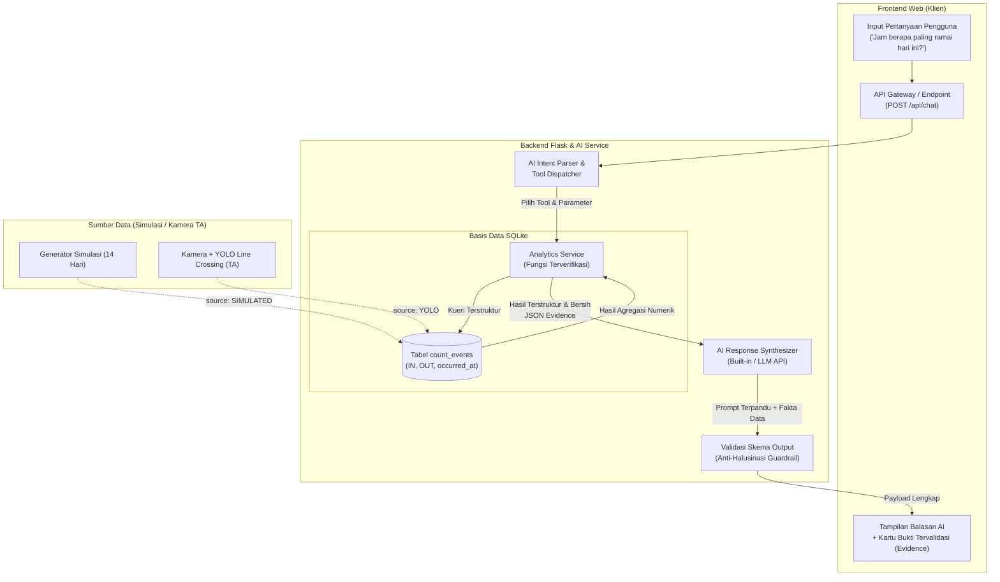

# DOKUMEN RANCANGAN SISTEM
# Smart People Analytics — AI Chat Analyst
**Mata Kuliah:** Kapita Selekta AI Engineering (Minggu 8 — Ujian Tengah Semester)  
**Penyusun:** Fajar  
**Topik / Konteks TA:** Pemantauan Orang Masuk/Keluar (People Counting) Berbasis Computer Vision & Line Crossing Tracking  
**Target Pengumpulan:** H-1 UTS Pukul 23.59  

---

## 1. Persoalan (Problem Formulation)

### 1.1 Siapa yang Mengalaminya?
Pengelola Laundry atau petugas keamanan yang membutuhkan visibilitas terhadap arus pergerakan manusia, tingkat keterisian ruangan (*occupancy*), serta jam-jam keramaian fasilitas publik secara akurat.

### 1.2 Bagaimana Diselesaikan Sekarang?
Saat ini, pemantauan umumnya mengandalkan:
1. **Pencatatan Manual**: Petugas satpam mencatat secara berkala dengan *hand counter*, yang rawan kelalaian dan diskontinu.
2. **Dashboard CCTV & Tabular Standar**: Sistem sensor/CCTV yang hanya menampilkan log mentah pergerakan atau tabel angka statis pada monitor.

### 1.3 Mengapa Solusi Saat Ini Belum Cukup?
- **Tingginya Beban Kognitif**: Staf operasional harus menyaring ribuan baris log data atau menyusun grafik manual untuk menjawab pertanyaan sederhana namun krusial, seperti: *"Jam berapa puncak kedatangan hari ini?"* atau *"Berapa persen lonjakan pengunjung dibanding kemarin?"*.
- **Ketiadaan Konteks dan Penjelasan Naratif**: Dashboard angka mentah tidak menyajikan interpretasi analitik, tren komparatif, maupun deteksi anomali.
- **Keterbatasan Kueri Pengguna Non-Teknis**: Pengelola fasilitas non-teknis tidak memiliki kemampuan menulis kueri SQL untuk melakukan agregasi runtun waktu (*time-series aggregation*) secara instan.

---

## 2. Mengapa AI Generatif? (Justification for Generative AI)

### 2.1 Mengapa Bukan Basis Data Biasa?
Basis data (misal SQLite/PostgreSQL) sangat andal dalam penyimpanan terstruktur dan agregasi matematis, namun kaku dalam antarmuka. Basis data tidak mampu memahami bahasa alami yang variatif, singkatan, konteks waktu relatif (*"kemarin"*, *"tadi siang"*, *"minggu lalu"*), serta tidak dapat merangkum temuan dalam narasi yang ramah pengguna.

### 2.2 Mengapa Bukan Formulir atau Aturan Biasa (Rules/Hardcoded Forms)?
Antarmuka formulir membutuhkan puluhan *dropdown*, *date-picker*, dan tombol filter kaku. Setiap kombinasi pertanyaan komparatif baru menuntut penambahan komponen UI baru. Aturan biasa (*if-else*) runtuh ketika pengguna mengajukan pertanyaan dengan struktur bahasa yang berbeda atau bernuansa ganda.

### 2.3 Mengapa AI Generatif Tepat (dan Batasannya)?
AI Generatif (Large Language Model) unggul dalam **pemahaman maksud (intent comprehension)** dan **sintesis penjelasan naratif**. Namun, LLM memiliki kelemahan fatal: **halusinasi numerik** (*math hallucination*). Oleh karena itu, arsitektur ini **TIDAK** membiarkan LLM menghitung data secara bebas. 

Sistem menerapkan prinsip pemisahan tanggung jawab (*separation of concerns*):
- **Basis Data**: Menyimpan fakta kejadian.
- **Backend Deterministik**: Menghitung angka secara presisi melalui fungsi analitik terverifikasi.
- **AI Generatif**: Menerjemahkan maksud pengguna menjadi pemanggilan fungsi (*Tool Calling*) dan merangkai hasil kalkulasi menjadi wawasan naratif dalam bahasa Indonesia.

---

## 3. Rancangan Sistem (System Architecture)

Alur lengkap dari masukan pengguna hingga luaran terverifikasi disajikan dalam diagram berikut:



### Penjelasan Alur:
1. **Input**: Pengguna memasukkan pertanyaan bahasa alami pada antarmuka web.
2. **Intent Parsing**: AI Service menentukan fungsi (*tool*) yang relevan beserta parameternya (misal `get_peak_period` dengan `start_date="2026-10-11"` dan `metric="IN"`).
3. **Eksekusi Analitik**: Backend mengeksekusi fungsi analitik deterministik terhadap SQLite, menghasilkan fakta numerik bebas halusinasi.
4. **Sintesis Naratif**: AI mengemas hasil angka tersebut ke dalam penjelasan bahasa Indonesia yang santun, mencantumkan periode, angka, dan sumber data.
5. **Output**: Antarmuka menampilkan narasi teks dan menyertakan kartu bukti (*Evidence Card*) yang memvalidasi bahwa angka bersumber dari basis data.

---

## 4. Kendali Output (Output Controls & Guardrails)

Untuk menjamin keandalan sistem dalam ranah rekayasa AI, luaran dikendalikan secara ketat melalui skema dan aturan validasi:

### 4.1 Skema Luaran API (`/api/chat`)
```json
{
  "status": "success",
  "session_id": "sess-xxxx",
  "answer": "Berdasarkan data SIMULATED pada tanggal 2026-10-11, periode dengan aktivitas orang masuk tertinggi adalah pukul 12:00 - 12:59 dengan total 35 orang.",
  "source": "SIMULATED",
  "period": {
    "date": "2026-10-11"
  },
  "evidence": {
    "tool": "get_peak_period",
    "arguments": {
      "start_date": "2026-10-11",
      "metric": "IN"
    },
    "result": {
      "peak_hour": "12:00 - 12:59",
      "count": 35,
      "source": "SIMULATED",
      "has_data": true
    }
  }
}
```

### 4.2 Nilai Valid dan Batasan (*Guardrails*)
1. **Non-Negativity Constraint**: Nilai hitungan `total_in`, `total_out`, dan `count` wajib $\ge 0$. Nilai okupansi diproteksi $\ge 0$ dengan penanda khusus (*anomaly flag*) jika arus keluar melebihi arus masuk yang tercatat.
2. **Strict Grounding Rule**: AI dilarang menyebutkan angka yang tidak tercantum dalam objek `evidence.result`.
3. **Mandatory Metadata**: Setiap penjelasan wajib menyebutkan: rentang tanggal, metrik (`IN` / `OUT`), angka hasil kalkulasi, dan label sumber data (`SIMULATED` atau `YOLO`).

### 4.3 Penanganan Output yang Tidak Valid / Out-of-Scope
- **Pertanyaan Luar Topik (Out-of-Scope)**: Bila pengguna menanyakan topik di luar analitik jumlah orang (misal resep masakan, politik, cuaca umum), sistem secara otomatis menolak dengan santun:  
  *“Maaf, saya adalah AI Chat Analyst khusus sistem Smart People Analytics. Saya hanya dapat membantu menjawab dan menganalisis data terkait pergerakan orang masuk, keluar, okupansi, jam sibuk, dan perbandingan antarperiode.”*
- **Data Kosong**: Jika tanggal yang ditanyakan belum memiliki rekaman, AI diwajibkan menyatakan secara transparan bahwa data belum tersedia di basis data, bukan mengarang angka perkiraan.

---

## 5. Tool dan Batas Akses (Tools & Permissions)

Sistem menggunakan pendekatan **Whitelisted Tools**. LLM sama sekali **tidak memiliki izin menjalankan SQL bebas (`DROP`, `DELETE`, `UPDATE`, `INSERT`, atau kueri arbitrer)**.

| Nama Tool | Parameter Input | Luaran Numerik | Otorisasi / Batasan Akses |
|---|---|---|---|
| `get_summary` | `start_date`, `end_date`, `camera_id` | `total_in`, `total_out`, `net_flow`, `estimated_occupancy` | **Read-Only**: Akses bebas pengguna |
| `get_hourly_counts` | `date_str`, `camera_id` | Array 24 jam `in_counts`, `out_counts`, `net_counts`, okupansi kumulatif | **Read-Only**: Akses bebas pengguna |
| `compare_periods` | `period1_start`, `period1_end`, `period2_start`, `period2_end`, `metric` | `difference`, `change_percent`, `change_percent_str`, `trend` | **Read-Only**: Akses bebas pengguna |
| `get_peak_period` | `start_date`, `end_date`, `metric`, `camera_id` | `peak_hour`, `peak_hour_start`, `count`, `source` | **Read-Only**: Akses bebas pengguna |
| `get_occupancy_estimate`| `target_date`, `baseline_occupancy` | `current_estimated_occupancy`, `total_in`, `total_out`, flag anomali | **Read-Only**: Akses bebas pengguna |

### Kapan Membutuhkan Persetujuan Manusia (*Human-in-the-Loop*)?
- **Pembersihan / Reset Data Histori**: Penghapusan data atau regenerasi dataset simulasi memerlukan konfirmasi pengguna (*modal confirmation dialog*).
- **Pengubahan Status Kamera / Kalibrasi Garis**: Penyesuaian garis hitung dan konfigurasi kamera pada tahap integrasi YOLO TA tidak dapat diubah oleh instruksi chat AI secara langsung.

---

## 6. Grounding dan Retrieval (Data Grounding Strategy)

### 6.1 Mengapa Structured Database Grounding, Bukan Text RAG?
Pada data pergerakan orang, informasi yang diolah adalah **data terstruktur numerik dan deret waktu (*time-series structured events*)**.
- **Vector RAG (Retrieval-Augmented Generation)** dengan chunking teks tidak cocok untuk data agregasi matematis karena *embedding vector* tidak mampu menjumlahkan baris, mencari nilai maksimum, atau menghitung persentase perubahan secara eksak.
- **Grounding yang Digunakan**: *Direct Structured Function Grounding*. AI diarahkan (*grounded*) pada fungsi backend yang mengeksekusi agregasi SQL deterministik langsung ke tabel `count_events`.

### 6.2 Penanganan Kasus Data Tidak Ditemukan
Jika kueri meminta tanggal atau periode tanpa rekaman:
1. Fungsi backend mengembalikan objek dengan atribut `"has_data": false` dan `"count": 0`.
2. AI mendeteksi bendera tersebut dan mengembalikan narasi informatif:  
   *“Berdasarkan data SIMULATED untuk tanggal tersebut, belum ada catatan kejadian orang masuk atau keluar yang tercatat di database.”*

---

## 7. Bukti Sejauh Ini (Evidence: Success & Self-Discovered Failure)

*Bagian ini memaparkan pengujian nyata yang diverifikasi melalui pengujian otomatis dan interaksi langsung.*

### 7.1 Satu Keberhasilan Nyata
- **Skenario**: Pengguna bertanya *"Bandingkan jumlah orang masuk pada 11 Oktober 2026 dengan kemarin."*
- **Kondisi Data**: Kemarin (10 Okt) tercatat 40 orang masuk; Hari ini (11 Okt) tercatat 60 orang masuk.
- **Hasil**: Sistem sukses memanggil `compare_periods`, menghitung selisih $+20$ orang, persentase perubahan $+50.00\%$, mengidentifikasi tren `NAIK`, dan menyajikan kartu bukti analitik (*evidence*) yang 100% cocok dengan verifikasi matematis manual.

### 7.2 Satu Kegagalan yang Ditemukan Sendiri (*Self-Discovered Failure*)
- **Deskripsi Kegagalan**:  
  Ketika membandingkan aktivitas hari ini dengan periode pembanding yang memiliki data bernilai nol (misalnya hari libur atau tanggal sebelum sistem mulai merekam, $N_{lama} = 0$), sistem backend mengalami kegagalan perhitungan pembagian dengan nol (*ZeroDivisionError*) pada rumus:
  $$\text{Perubahan (\%)} = \frac{N_{baru} - N_{lama}}{N_{lama}} \times 100\% \implies \frac{N_{baru} - 0}{0} \times 100\%$$
  Sebelum diperbaiki, AI menghasilkan balasan yang membingungkan atau menyebut persentase adalah $0\%$ secara keliru.
- **Akar Masalah (*Root Cause*)**:  
  Fungsi komparasi mengasumsikan penyebut selalu bernilai positif tanpa memvalidasi kondisi batas (*boundary condition*) ketika $N_{lama} = 0$.
- **Tindakan Perbaikan & Solusi**:  
  Logika penanganan khusus ditambahkan pada `AnalyticsService.compare_periods()`:
  ```python
  if n_lama == 0:
      if n_baru == 0:
          change_percent = 0.0
          change_percent_str = "0.0% (Kedua periode 0)"
      else:
          change_percent = None # Undefined secara matematis
          change_percent_str = f"+{n_baru} (Basis awal 0)"
          note = "Data periode pembanding adalah 0, persentase tidak terdefinisi secara matematis."
  ```
  Kasus batas ini kini diuji secara ketat dan dinyatakan **LULUS** pada pengujian otomatis `test_compare_periods_zero_division` di [tests/test_analytics.py](file:///c:/Users/mfaja/OneDrive/Dokumen/Kuliah/KapitaSelekta/tests/test_analytics.py).

---

## 8. Risiko dan Rencana Minggu 9–16 (Risks & Roadmap AI Chat Analyst)

### 8.1 Risiko Utama yang Diidentifikasi (AI Chat Analyst)
1. **Ambiguitas Bahasa Alami & Resolusi Waktu Kompleks (*Temporal Parsing Ambiguity*)**:
   Pengguna kerap mengajukan pertanyaan dengan frasa waktu relatif atau majemuk, seperti *"jam sibuk tadi siang"*, *"hari kerja minggu lalu"*, atau *"dua hari lalu dibanding hari ini"*. Risiko utama adalah AI salah mengekstraksi parameter rentang tanggal (`start_date`, `end_date`), sehingga data yang dianalisis tidak sesuai dengan maksud pengguna tanpa disadari.
2. **Keterbatasan *Single-Turn Tool Calling* pada Kueri Komposit (*Multi-Step Analytics*)**:
   Saat pengguna menanyakan pertanyaan multi-langkah—misalnya: *"Jam berapa paling ramai hari Senin lalu, dan berapa persen perbedaannya dengan jam paling ramai hari ini?"*—arsitektur satu panggilan tool (*single tool call per turn*) belum mampu mengeksekusi rangkaian tool berantai (*sequential tool calling*).
3. **Risiko Halusinasi Kausalitas (*False Causality Hallucination*)**:
   Ketika pengguna bertanya di luar ranah numerik (misal: *"Mengapa jam 14.00 sepi?"* atau *"Apakah hujan yang menyebabkan penurunan pengunjung?"*), terdapat risiko model bahasa berhalusinasi mengarang alasan eksternal yang tidak tercatat dalam basis data.
4. **Keandalan & Latensi Layanan LLM (*API Failover & Latency Variability*)**:
   Ketergantungan pada API cloud eksternal memiliki risiko latensi jaringan, fluktuasi kuota, atau pemutusan koneksi saat sesi analitik berlangsung.

### 8.2 Rencana Kerja Minggu 9–16 (Fokus Pengembangan AI Chat Analyst)
- **Minggu 9–10: Implementasi *Multi-Step Chained Tool Calling***
  - Mengembangkan kapabilitas *chain-of-thought tool execution*, memungkinkan AI memanggil beberapa fungsi analitik secara berurutan dalam satu giliran percakapan untuk menjawab pertanyaan komparatif tingkat lanjut.
- **Minggu 11–12: Kontekstual Percakapan Multi-Turn & *Advanced Temporal Engine***
  - Menyempurnakan manajemen *state* memori percakapan, sehingga kueri lanjutan seperti *"Kalau dibandingkan hari sebelumnya bagaimana?"* dapat mempertahankan konteks tanggal rujukan dari pertanyaan sebelumnya.
  - Memperluas pustaka resolusi waktu bahasa Indonesia (mendukung *"kuartal ini"*, *"hari kerja vs akhir pekan"*, *"libur nasional"*).
- **Minggu 13–14: *Causal Guardrails* & Benchmark Evaluasi AI Otomatis (*LLM Evaluation*)**
  - Menerapkan *guardrail* ketat yang melarang AI berspekulasi tentang penyebab eksternal yang tidak memiliki bukti data, memastikan jawaban tetap objektif.
  - Membangun *test benchmark dataset* berisi 50+ variasi kueri analitik untuk mengukur *Tool Selection Accuracy*, *Parameter Precision*, dan *Zero-Hallucination Rate*.
- **Minggu 15–16: *Proactive Insights* & Generator Laporan Eksekutif Otomatis**
  - Mengembangkan fitur di mana AI Chat Analyst dapat memberikan wawasan proaktif (misal mendeteksi anomali lonjakan arus tanpa ditanya).
  - Menyediakan fitur pembuatan rangkuman laporan analitik otomatis (*Executive Briefing Report*) harian/mingguan yang dapat diunduh pengguna.

---

## 9. Lampiran Pertanggungjawaban Desain (Jawaban 3 Pertanyaan Wajib)

### Pertanyaan 1: Satu keputusan rancangan yang dapat dibuat berbeda dan alasannya
> *"Saya memilih arsitektur **Deterministic Tool Calling** alih-alih **Text-to-SQL berbasis LLM**. Alternatif Text-to-SQL memungkinkan LLM menulis kueri SQL bebas secara fleksibel. Namun, alternatif tersebut berisiko tinggi terhadap kesalahan sintaks SQL, ketidakmampuan menjamin kebenaran agregasi waktu, dan kerentanan keamanan database. Dengan Tool Calling, LLM dibatasi hanya memanggil fungsi-fungsi analitik yang telah diverifikasi secara matematis oleh backend Flask."*

### Pertanyaan 2: Input yang membuat sistem gagal dan penyebab utamanya
> *"Input yang membandingkan hari ini dengan tanggal tanpa aktivitas ($N_{lama} = 0$). Penyebab utamanya adalah pembagian dengan nol pada rumus persentase perubahan standar. Masalah ini telah saya mitigasi dengan logika kondisional khusus di backend yang mengembalikan label eksplisit bahwa basis awal bernilai 0, sehingga sistem tidak crash dan AI tidak berhalusinasi."*

### Pertanyaan 3: Bagian karya yang dibuat dengan bantuan AI dan cara memverifikasinya
> *"Sebagian besar kode *boilerplate* Flask, skrip UI Chart.js, serta kerangka fungsi analitik diinisiasi dengan bantuan asisten AI. Saya memverifikasinya secara ketat menggunakan **pengujian otomatis Pytest (10 kasus uji)** yang mencakup rekap numerik manual, pembagian nol, pengelompokan 24 jam, serta pengujian boundary condition. Selain itu, saya memverifikasi respons integrasi API secara langsung melalui skrip tes konsol dan inspeksi database SQLite."*
